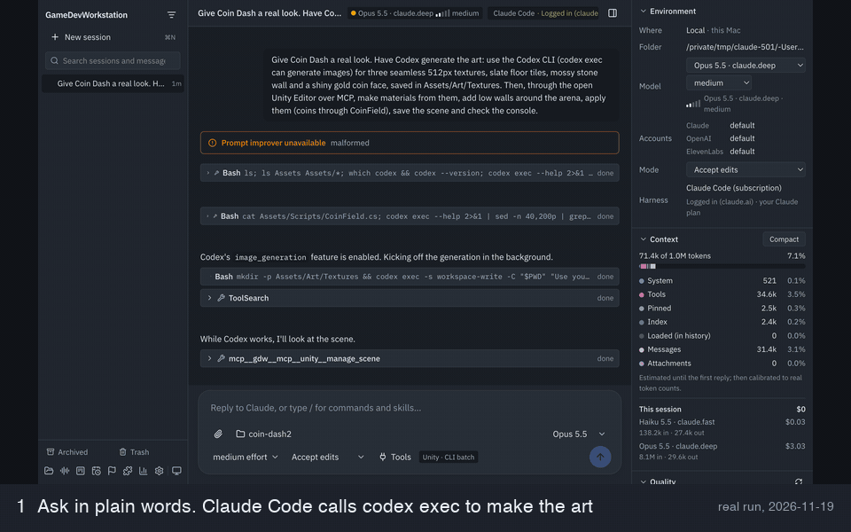
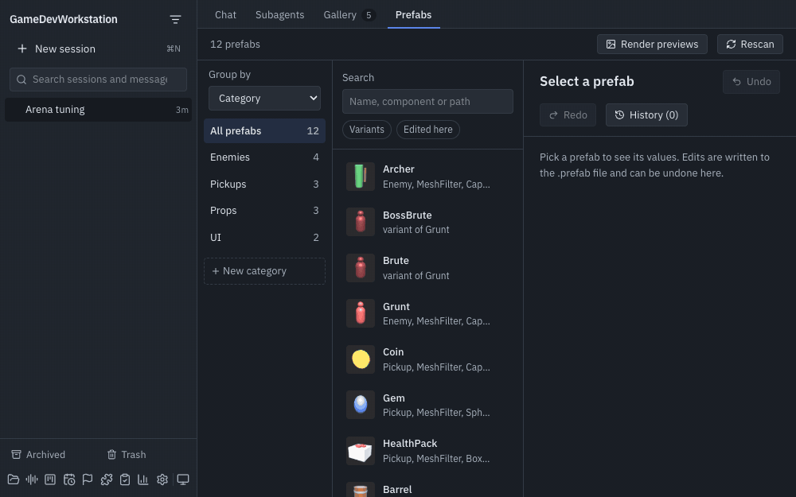
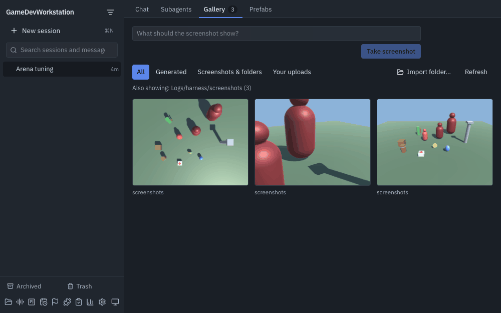
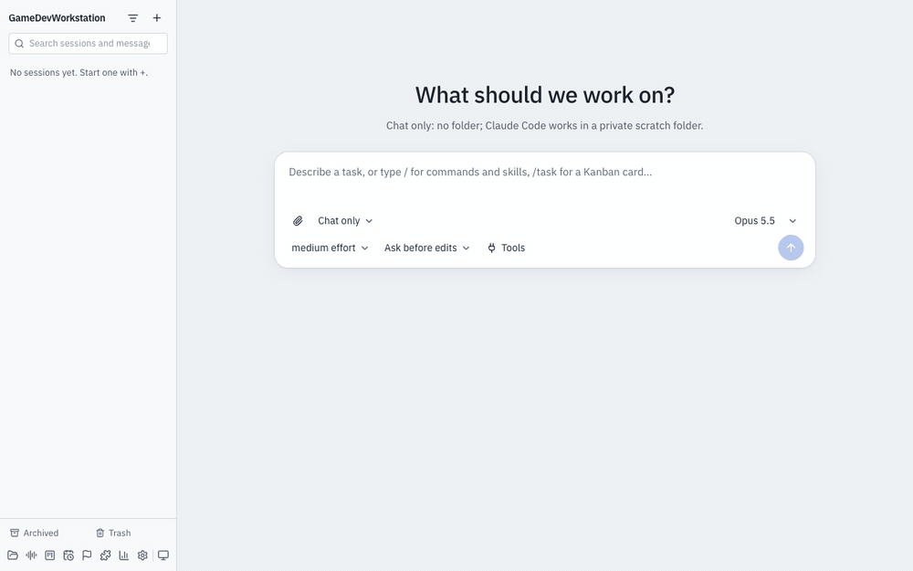
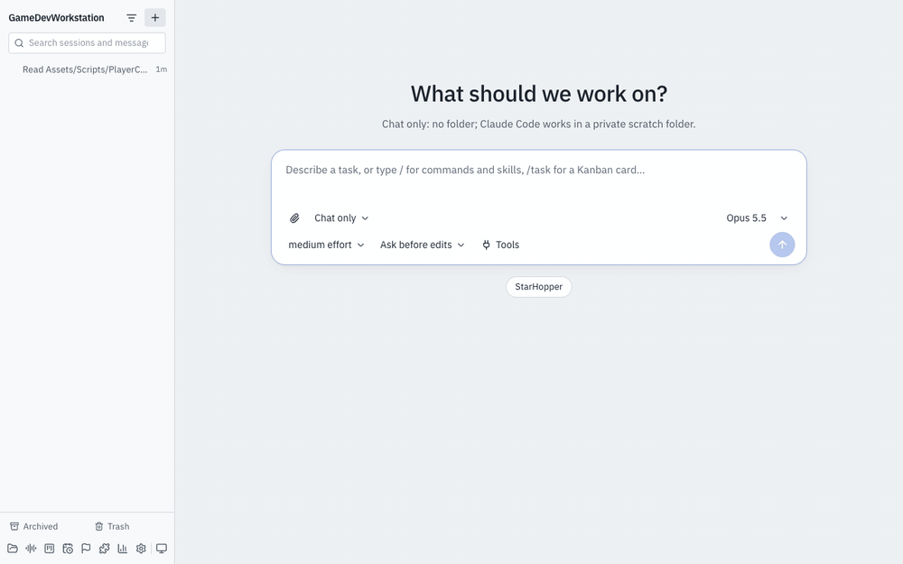
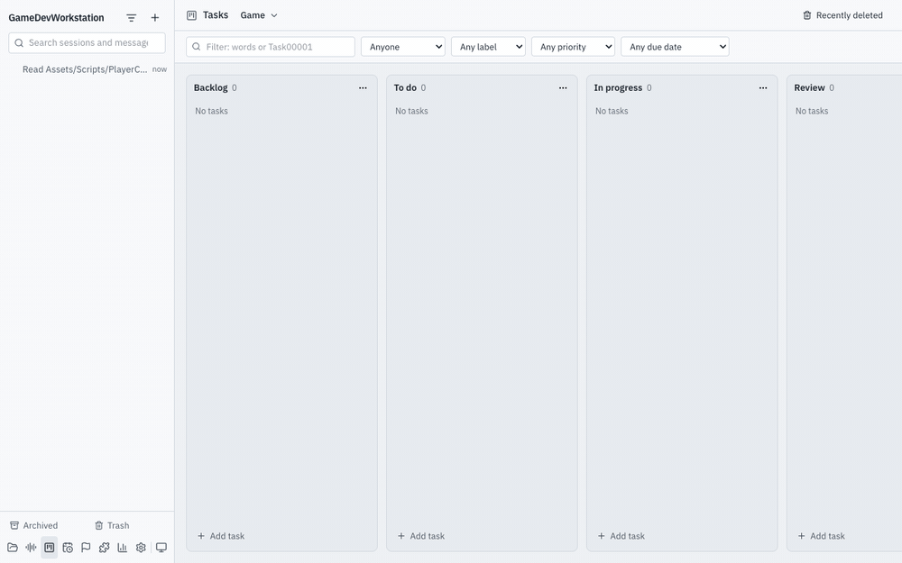
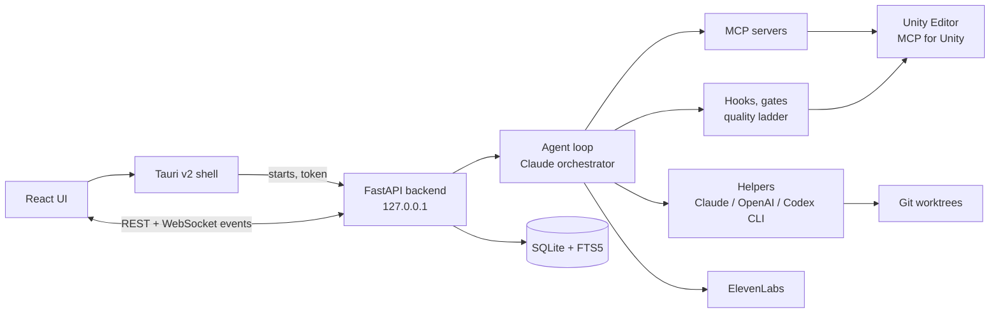

<div align="center">


# GameDevWorkstation

**A desktop workstation for building Unity games with AI agents. Claude runs the job, hands pieces to Claude and
Codex helpers, works inside the Unity Editor, and the app (not the model) decides when the work is really done.**

[](https://github.com/ArshiaJahan/GDH/actions/workflows/ci.yml)
[](#quick-start)
[](#windows-experimental)
[](#built-for-unity)
[](VERSION)
[](LICENSE)
<br>
[](pyproject.toml)
[](frontend/package.json)
[](src-tauri/Cargo.toml)

[Quick start](#quick-start) ·
[What it does](#what-it-does) ·
[Why use it](#why-use-it) ·
[See it in action](#see-it-in-action) ·
[Built for Unity](#built-for-unity) ·
[How it works](#how-it-works) ·
[Full guide](docs/GUIDE.md)

</div>

---



<sub>One real session from 2026-11-19, shortened and sped up. Claude Code drives Unity 6000.3 through MCP for Unity
in a copy of the <a href="examples/unity-sample">sample project</a>, and Codex makes the three textures. The gameplay
clip is a recorded run (seed 42) that replayed in batch with all 1,968 frame hashes matching, checked by hand that day
(commit <a href="https://github.com/ArshiaJahan/GDH/commit/2316b11">2316b11</a>). A demo-only autopilot steers the
player.</sub>

<p align="center"><a href="https://github.com/ArshiaJahan/GDH/releases/latest"><b>⬇ Download the latest release</b></a> · macOS 13+ (Apple Silicon) · Windows x64 (experimental)</p>

## Quick start

**The easy way:** grab [the latest release](https://github.com/ArshiaJahan/GDH/releases/latest). There's a macOS app
(`-macos-arm64.dmg`) and a Windows installer (`-x64-setup.exe`). Neither is notarized yet, so the first time you open
it on macOS, right-click the app and choose **Open**; on Windows, SmartScreen will warn you once. After that the app
keeps itself up to date: it downloads new releases and installs them when no session is running.

Then open **Settings → Accounts** and add your Anthropic key (OpenAI and ElevenLabs are optional). Already use Claude
Code? You can run sessions with your own `claude` login instead.

**Hooking up Unity:** you have two options.
- **MCP for Unity:** add `com.coplaydev.unity-mcp` to your project, run
  `uvx --from mcpforunityserver==10.3.0 mcp-for-unity` once while you're online, open the Editor, and start with the
  `unity-router` skill (`/skill unity-router` in the composer).
- **The Unity CLI:** if Unity Hub's CLI is installed, set the Unity backend to CLI in **Settings → Unity**. Batch jobs
  need nothing in your project; working with the open Editor needs the `com.unity.pipeline` package, and the app
  offers to add it.

**Building from source** (macOS 13+ on Apple Silicon, Xcode Command Line Tools, Node 20+,
[uv](https://docs.astral.sh/uv/) with Python 3.11+, Rust stable, and the Codex CLI if you want it):

```bash
git clone https://github.com/ArshiaJahan/GDH.git
cd GDH
make dev        # builds the UI, starts the backend on 127.0.0.1:8765 and opens it in your browser
```

Want to look around without any keys? Run it with `GDW_FAKE_PROVIDERS=1`. More build commands are under
[Building and testing](#building-and-testing).

## What it does

AI coding agents write C# well. What they're bad at is knowing when a game change is actually *finished*: it
compiles, the tests pass, it plays right and it looks right. GameDevWorkstation is built around that gap.

You describe what you want in a session, much like chatting with Claude. Behind the scenes:

- **Claude plans and delegates.** It splits the job into units and hands them to Claude or OpenAI (Codex) helpers,
  in parallel, each in its own git worktree, picking the model and effort per unit and staying inside your budget.
- **It works in Unity itself.** Through MCP for Unity or the official Unity CLI, it compiles, runs tests, takes
  screenshots, edits scenes and prefabs, and records and replays play sessions, with the Editor open or closed.
- **The app checks the work.** A turn can't end while the project doesn't compile. A story isn't marked done without
  fresh evidence the app saw for itself: compile output, test results, play logs, screenshots, and a design review if
  you want one.
- **It remembers your project.** Your taste (`TASTE.md`), past mistakes (`POSTMORTEMS.md`), conventions and current
  milestone are kept in front of the agent, so it doesn't repeat yesterday's bug.
- **Everything stays on your machine.** The backend only listens on `127.0.0.1`, keys live in the macOS Keychain,
  and risky actions (shell commands, deletes, edits in Ask mode) wait for your approval.

## Why use it

- **"Done" means done.** Agents often say they're finished when they aren't. Here, gates and a four-level quality
  ladder (compile, behaviour tests, play evidence, critique) decide, based on evidence the app collected itself.
- **It speaks Unity.** Twenty Unity 6 skills cover compile-and-fix loops, Play Mode checks, safe scene and prefab
  edits, record and replay, performance and game-feel passes, headless builds, trailers and shipping.
- **You see your game, not just a chat.** The **Prefabs** tab shows every prefab with a Unity-rendered thumbnail and
  lets you tweak values (no AI, no tokens) with undo. The **Gallery** collects every screenshot and render. The agent
  sees both tabs too, so you're always looking at the same thing.
- **Parallel work, kept under control.** Several helpers can work at once without stepping on each other, and spend
  limits, job budgets and approval for high effort keep costs predictable. A usage page shows what each model cost.
- **Big goals in steps.** Workflows (bug fix, new mechanic, juice pass, release, …) and multi-session campaigns run
  phase by phase, and the app checks each phase before moving on.
- **Fits how you already work.** Use the built-in agent with API keys, or your own Claude Code login. Your task board,
  CI failures (`gdw triage`) and agent evals (`gdw eval`) live in the same place.

## See it in action

**Prefabs tab.** Every prefab in the project with a thumbnail Unity rendered, grouped by folder. Edit a value, or
select several prefabs and change them all at once, then undo it from the history.



**Gallery tab.** All of a session's screenshots, renders and media in one place: Unity captures, generated images,
your uploads and any folder you import.



**A Claude Code session in a Unity project.** Pick a folder, describe the task, and Claude Code reads the project and
answers, with the environment, context use and connectors alongside.



**Skills.** Type `/skill` in the composer to pick one, or browse and filter them on the Skills & MCP page.



**Task board.** A Kanban board you share with the agent; tasks get codes like `Task00001`.



<sub>Recorded from the app's own UI in a browser. The Claude Code reply is a real run. The Prefabs and Gallery clips
use a small demo Unity 6000.3 project whose thumbnails and screenshots Unity rendered in batchmode.</sub>

### Where things stand

As of the [v0.8.1 CI run on `main`](https://github.com/ArshiaJahan/GDH/actions/runs/45738539164) (2026-11-26):

- **2,503 backend and 222 frontend tests** pass on every push on a macOS runner, and a Windows runner builds the
  installer and smoke-tests its backend.
- **CI failure triage** puts 26 of 26 labelled failed CI logs in the right category
  ([`tests/test_triage_fixtures.py`](tests/test_triage_fixtures.py); it was 24 of 26 before the rules were tuned).
- **6 releases** so far ([v0.6.0 to v0.8.1](https://github.com/ArshiaJahan/GDH/releases)), each with a macOS app and a
  Windows installer that CI builds and publishes.

> [!IMPORTANT]
> **Made for macOS.** GameDevWorkstation targets macOS 13 or later on Apple Silicon. The
> [Windows build](#windows-experimental) is experimental. CI builds it and checks that the backend starts, but nobody
> has tested the desktop app by hand on Windows yet, and the built-in terminal is macOS-only. Linux isn't supported.

---

## Highlights

The eight that matter most; the guide has [all the features](docs/GUIDE.md#all-features).

| | |
|---|---|
| **Orchestrator and helpers** | Claude plans the job and hands units to Claude and OpenAI helpers (API or Codex CLI), choosing the model tier and effort for each, with parallel git worktrees for code. |
| **Unity skill pack** | 20 Unity 6 skills behind a router: compile/fix loops, Play Mode checks, record and replay, headless builds, safe scene and prefab edits, performance and game-feel passes, trailers, shipping. |
| **Quality ladder L1–L4** | A story only reaches `done` with fresh evidence the app saw itself: it compiles, tests pass, play evidence and screenshots, a design critique. |
| **Prefabs and Gallery** | Browse and edit prefab values with Unity-rendered thumbnails and undo; collect every screenshot, render and imported folder in one grid. The agent can use both. |
| **Record and replay** | Record a play session in the open Editor, replay it frame by frame with state hashes checked at checkpoints, and export a silent GIF or MP4. Input System only. It promises repeatability on the same machine for the state you register; a mismatch is reported, not hidden. |
| **CI failure triage** | `gdw triage <run-id\|log>` sorts a failed CI run into compile, test, flaky, infra, dependency or timeout, and points at the file and line. It reads GitHub Actions, pytest, vitest, tsc, cargo, npm and uv logs, plus Unity's Editor.log and NUnit XML. Rules go first and a model only handles what they can't place. A GitHub Action posts the report on failed PRs. See [CI failure triage](docs/GUIDE.md#ci-failure-triage). |
| **Claude Code sessions** | Run your own `claude` CLI and login (checked with claude 2.1.308 on a claude.ai subscription) with GameDevWorkstation's tools, approvals, Plan mode and `--resume`. See [Claude Code sessions](#claude-code-sessions). |
| **Eval Forge** | `gdw eval forge <commit>` turns a merged commit into an agent task with hidden graders; `gdw eval validate` makes sure the graders catch bad solutions; `gdw eval run` compares Claude Code, Codex and the built-in agent on pass@k, cost, time and tool calls, and says whether a failure was the agent, the environment or the grader. Tasks export to Harbor / Terminal-Bench 2.0. On the 13-task seed suite every reference solution passes and 111 of 168 flawed ones are caught. A first Claude Code run (Opus 5.5, k=3, 2026-11-20) scored 28% pass@1 and 31% pass@3. See [Eval Forge](docs/GUIDE.md#eval-forge). |

## Built for Unity

### The skill pack

`unity-router` is where you start. It picks the few skills a task needs and whether to work through the open Editor
(MCP) or in batchmode.

| Skill | What it's for |
|---|---|
| [`unity-router`](skills/unity-router/SKILL.md) | Sends a task to the right Unity skills; ships the Unity gates preset |
| [`unity-onboarding`](skills/unity-onboarding/SKILL.md) | Gets a session up to speed with one cached scan of the project's docs, tools, git state and prefabs, then asks which to-do to take; also sorts the Prefabs tab by folder |
| [`unity-practices`](skills/unity-practices/SKILL.md) | Unity 6 practices for code, enemies, pooling, textures, performance and tuning, with a C# linter, a texture audit and ready-made kits |
| [`compile-fix-loop`](skills/compile-fix-loop) | Compile, read the console, fix, repeat, and know when to stop |
| [`play-verify`](skills/play-verify) | Play Mode checks with `[VERIFY]` signals, screenshots and scripted input |
| [`headless-ops`](skills/headless-ops) | Batchmode compiles, tests, builds, screenshots and prefab previews with the Editor closed |
| [`scene-prefab-safety`](skills/scene-prefab-safety) | Safe scene and prefab edits |
| [`gdd-to-backlog`](skills/gdd-to-backlog) | Turns a design doc into a linted `BACKLOG.md` with acceptance criteria |
| [`project-memory`](skills/project-memory) | `PROJECT.md`: decisions, conventions, gotchas and the current milestone |
| [`architecture-patterns`](skills/architecture-patterns) | Architecture templates for Unity code |
| [`asset-pipeline`](skills/asset-pipeline) | Import settings and asset workflows |
| [`perf-pass`](skills/perf-pass) | Profiling plus a static anti-pattern audit |
| [`game-feel-pass`](skills/game-feel-pass) | Juice and feedback tuning |
| [`build-ship`](skills/build-ship) | Builds and release prep |
| [`vcs-hygiene`](skills/vcs-hygiene) | Git hygiene for Unity projects |
| [`unity-mcp-orchestrator`](skills/unity-mcp-orchestrator) | MCP for Unity tool reference and workflows |
| [`design-critique`](skills/design-critique) | A review by three independent reviewers against your `TASTE.md` |
| [`postmortem`](skills/postmortem) | Writes `POSTMORTEMS.md` entries and suggests how to enforce the lesson |
| [`replay`](skills/replay/SKILL.md) | Record and replay play sessions, check frame hashes, export a silent GIF or MP4 |
| [`trailer-maker`](skills/trailer-maker/SKILL.md) | From a brief to captured footage, an ffmpeg edit, ElevenLabs music and voice-over, and platform exports |

General skills come with it too: `delegation` (on by default), `game-designer`, `graphify`, `grilling`,
`claude-handoff` and two Claude delegation strategies.

### Prefabs

The **Prefabs** tab lists every prefab in a Unity project by category, folder or main component, with search and
filters for variants and edited prefabs. `unity-onboarding` sets up the categories, one per folder.

Values are read straight from the `.prefab` files by a script, so there's no AI involved and no tokens spent. Script
components come first and built-in ones fold away. On a variant, each value tells you whether it's inherited or
overridden. Edits are small, atomic changes to the file. Select several prefabs to set a shared value on all of them
in one step; bases are written before their variants, so the variants keep inheriting. Undo, redo and history work
per project, and undo warns you if the file changed in the meantime.

**Render previews** asks Unity to draw a thumbnail of each changed prefab in a preview scene, with the Editor open or
closed, after you approve it. The agent can read and edit the same data with its `prefabs` tool, and its edits land
in the same history, so you can undo them from the tab.

### Gallery

The **Gallery** tab shows a session's images, videos and audio: what its tools generated, your uploads, Unity
captures in `Logs/harness/screenshots/`, replay renders, and any folder you import with **Import folder…** (files are
only served from those folders). Filters split generated media, screenshots and folders, and uploads.

Type what a screenshot should show ("player at the cave entrance, night, low angle") and a small side agent frames the
shot in Unity and takes it: through MCP for Unity or the Unity CLI with the Editor open, or a batch render with the
Editor closed. It only writes into `Logs/harness/screenshots/` and never edits your source files or saves a scene. If
a capture fails, the card tells you why, offers the fix (for example installing the harness editor scripts) and lets
you retry. The agent sees the same list through its `gallery` tool. More in the [guide](docs/GUIDE.md#gallery).

### Unity: MCP or CLI

Choose how the app drives Unity with the **Unity backend** (Settings → Unity, or `[unity] backend` in `config.toml`).
You can set a project default and change it per session from the chip under the composer.

| Backend | Editor open | Editor closed |
|---|---|---|
| `mcp` | [MCP for Unity](https://github.com/CoplayDev/unity-mcp) 10.3 (the built-in `unity` server, through `uvx`) | `headless-ops` `unity.sh` in batchmode |
| `cli` | The official [Unity CLI](https://docs.unity.com/en-us/unity-cli) against the open Editor (needs the `com.unity.pipeline` package) | `unity run` / `unity test` / `unity build` in batch mode (else `unity.sh`) |
| `auto` (default) | MCP if it's connected, otherwise the Unity CLI | The Unity CLI if it's installed, otherwise `unity.sh` |

The Unity CLI ships with Unity Hub; the app finds it in `~/.unity/bin`, the Hub bundle or your `PATH`. If the Editor
has the project open and nothing can talk to it, the app won't run a second Unity on the same project. Instead the
chip offers a way out: install the Pipeline package, use MCP once, work on a copy of the project, or close Unity. A few
batch jobs (asset import, menu items, screenshots, prefab previews, forced recompiles, builds through `unity.sh`) need
three small editor scripts; the app installs them when you ask, kept out of git. Unity jobs stream to the terminal
drawer and can be cancelled. Details: [Unity: MCP or CLI](docs/GUIDE.md#unity-mcp-or-cli).

### Quality ladder

A level only passes on evidence that the app **saw itself** (an agent saying so never counts), that's **fresh** (newer
than the last change to the files it depends on), and that's **tied** to a `BACKLOG.md` story or acceptance criterion.

| Level | Passes when | Seen in |
|---|---|---|
| **L1** Compile | The newest compile is newer than the newest code change, with 0 errors | Unity log / console, compile gate |
| **L2** Behaviour | Each EditMode/PlayMode criterion's tests passed after the last change | NUnit XML, MCP `run_tests` |
| **L3** Play evidence | Play-verify criteria passed on a fresh log; visual stories have a fresh screenshot | `check_criteria`, screenshots on disk |
| **L4** Critique | `critique()` passed, or you accepted it yourself | Three reviewer helpers |

Marking a story `done` in `BACKLOG.md` without that evidence is refused.

### Gates

The Unity gates preset ([`skills/unity-router/hooks.toml`](skills/unity-router/hooks.toml)) is off until you accept a
one-time offer per project, which approves exactly the tools and commands it runs:

- **block-generated**: edits to `Library/`, `Temp/`, `*.csproj` and other generated files are refused.
- **cs-compile** (L1): a turn that changed code can't finish until the project compiles; after 2 fix attempts it's
  handed back to you.
- **merge-compile**: a worktree merge that brought code gets compiled.
- **verify-tests** (L2): EditMode tests in a campaign's verify phase.
- **antipatterns**: scans changed scripts; a warning normally, a blocker in the Performance pass and Release
  workflows.
- **backlog-lint**: lint errors after `BACKLOG.md` is written.

Your own hook files (`.gamedevworkstation/hooks.toml`) are ignored until you trust them by hash, and a breaker stops a
turn that keeps hitting the same error.

### Anti-pattern ratchet

[`unity_antipatterns.py`](skills/perf-pass/scripts/unity_antipatterns.py) follows hot methods (`Update`,
`FixedUpdate`, `On*Stay*` and what they call) and flags `GetComponent`, `Find*`, `Camera.main`, LINQ, string and
collection allocations, `Debug.Log`, missing event unsubscribes and more, with a weighted score. A baseline in
`.gamedevworkstation/antipatterns-baseline.json` means only *new* problems count against you.

### Taste, critique and postmortems

- **`TASTE.md`**: three words, ranked rules of thumb, anti-patterns and hard limits for your game.
- **`design-critique`**: a Spec Auditor, a Player Advocate and an Art Director review fresh screenshots. The lowest
  score counts; after two rounds, you decide.
- **`POSTMORTEMS.md`**: each lesson has an `Applies to:` pattern, and the agent is reminded of it the first time it
  touches a matching file in a session.

### Trailers

[`trailer-maker`](skills/trailer-maker/SKILL.md) cuts a trailer from your real game, never from generated footage. You
agree on a brief (type, one-line message, length, platforms, call to action). The agent writes a beat sheet with a
hook in the first 10 seconds and a shot list, then records each shot in Play Mode with the Unity Recorder. Scripts
drive `ffmpeg` for cuts, cards, music timed to the beats (an ElevenLabs composition plan), voice-over with ducking,
−14 LUFS loudness and captions. Three reviewer helpers look at contact sheets before export. You get a Steam master at
1080p with a poster frame, a YouTube cut and a 9:16 cut for Shorts and TikTok, each quality-checked.

It needs `ffmpeg` on your PATH (`brew install ffmpeg`) and the `com.unity.recorder` package, and capture needs the
Editor open, because the Recorder doesn't run in batchmode.

## Campaigns and workflows

A **workflow** runs a fixed set of phases in one session: type `/workflow <id> <what to do>` in the composer, or pick
one under **Workflows** in the skills menu. A **campaign** spreads a bigger goal across several sessions. A planning
session writes the goal and scope to `.gamedevworkstation/campaigns/<slug>.md`, a validator checks the plan covers
what you asked for, you approve it, and each phase then runs in a fresh session with a brief built from that file.

Either way, the agent hands off when it thinks a phase is done, and the **app** checks the phase's conditions: files,
scripts, gates, quality-ladder levels, fresh screenshots, or your own pass/fail. A failed check costs a retry, and the
last retry parks the run for you to look at.

| Template | Phases |
|---|---|
| `new-mechanic` New mechanic | Spec → backlog story → code → compile → behaviour tests → play-verify → commit |
| `bugfix` Bug fix | Reproduce with a failing test → fix → repro test and suite pass → commit |
| `juice-pass` Juice pass | Baseline screenshots → game-feel pass → before/after evidence → design critique → commit |
| `content-batch` Content batch | Plan the items → make them (one helper per item folder) → wire them up → verify |
| `perf-pass` Performance pass | Baseline perf report → fix loop (anti-pattern gate blocking) → compare |
| `release` Release | Freeze → full tests → build → headless smoke test → spec-audit critique → changelog and tag |
| `replace-system` Replace a system | Build alongside → check parity → switch over → remove the old system |
| `milestone` Milestone (campaign only) | One phase per story of the current milestone, then the milestone exit |
| `trailer` Trailer (from `trailer-maker`) | Brief → beat sheet → shot list → capture → rough cut → music, voice-over and SFX → review → exports |

The **Campaigns** page lists every run with its status, phase, spend and checks, with Pause, Resume, Park, Abandon and
Rollover. The app never resets your files; it shows you the restore command instead. Autopilot keeps a running
campaign going while it's making progress, within its budget and limits.

## How it works



The desktop shell starts the bundled backend on a random port with a random token and shows the UI. The backend runs
the agent loop, the helpers, MCP servers and gates. Every change goes out on an event bus and streams to the window
over a WebSocket, which catches up on anything it missed after a reconnect. Config and data live in
`~/Library/Application Support/GameDevWorkstation/`, logs in `~/Library/Logs/GameDevWorkstation/`.

### Claude Code sessions

Sessions can run your own `claude` CLI and login. This was checked against claude 2.1.308 on a claude.ai
subscription: login detection, the stream-json protocol, the PreToolUse hook, the permission prompt tool,
GameDevWorkstation's MCP tools, Plan mode's plan card, questions, Stop and `--resume` (redacted captures are in
`tests/fixtures/claude_stream/`).

Settings files default to **None**: your ~/.claude hooks, plugins and settings files are ignored. That uses an empty
`--setting-sources=`, so no user, project or local settings, CLAUDE.md, skills, agents or plugins load; admin policies
still apply. You can switch to `user,project,local` instead. The app adds its own CLAUDE.md and skills context itself,
capped at 64 KB.

The CLI's env allowlist only passes shell and locale variables, `SSH_AUTH_SOCK`, proxies, `XDG_*` and the app's
`MCP_TOOL_TIMEOUT`, never your credentials or other secrets. Each process gets its own MCP bearer token, which is
revoked (and its config file removed) when the process ends. A hook registration failure stops the process with an
error rather than quietly running without it. Plan mode blocks known edits and commands, and other tools get an
approval card. Subscription logins record estimates outside your spend limits; API-key logins record
`billing='api'` and are checked against your spend limits before each turn. More in the
[guide](docs/GUIDE.md#claude-code-sessions).

### Security model

- **Approvals and allowlist.** Shell commands, deletes, edits in Ask mode, MCP tools that change things, and effort
  above high all show an approval card. Allowlist rules (`run_command:git status*`) never match command lines with
  `;`, `|`, `$(…)` and the like.
- **Modes.** Plan only, Ask and Accept edits. In Plan only, nothing can edit or run a command.
- **Untrusted content.** Web pages, MCP output, helper output and the Unity console reach the model inside randomly
  tagged `<untrusted-…>` blocks, marked as data and never as instructions.
- **Secrets.** API keys and secret-looking MCP settings live in the macOS Keychain; the UI only ever shows the last
  four characters.
- **Isolation.** Hook files need to be trusted by hash, the app's own git calls skip repository hooks, and
  `web_fetch` refuses private and local addresses.

### Configuration

Defaults ship with the app, and [`config.example.toml`](config.example.toml) lists them with comments. Your
`config.toml` only holds what you change, and most of it is in Settings: model tiers, delegation budgets, spend
limits, modes and allowlist, and the `[skills]`, `[hooks]`, `[ladder]`, `[campaigns]`, `[fleet]` and `[unity]`
sections. See the [guide](docs/GUIDE.md#configuration).

OpenAI tiers:

| Tier | Model | Work |
| --- | --- | --- |
| `codex.fast` | `gpt-6.1-sol` | Quick mechanical coding |
| `codex.standard` | `gpt-6.1-sol` | Regular coding |
| `codex.deep` | `gpt-6.2-sol` | Complex coding and design |
| `codex.computer` | `gpt-6.1-terra` | Computer use, screenshots and visual checks |
| `codex.cli` | `gpt-6.1-sol` | Codex CLI runs |

### Windows (experimental)

Each [release](https://github.com/ArshiaJahan/GDH/releases/latest) has an NSIS installer, and every CI run on `main`
uploads one as the `GameDevWorkstation-windows-x64` artifact. It isn't signed, so SmartScreen warns on first run. To
build it yourself on Windows (Node 20+, uv, Rust with MSVC and the Visual Studio C++ build tools):

```powershell
powershell -ExecutionPolicy Bypass -File scripts\build_windows.ps1   # dist\GameDevWorkstation-<version>-x64-setup.exe
```

On Windows, data lives in `%APPDATA%\GameDevWorkstation`, API keys in Windows Credential Manager, agent commands run
in PowerShell, and cancelling a job ends its whole process tree. Updates run the new installer silently and restart
the app; rolling back is macOS-only. The terminal drawer isn't there yet, and the Unity MCP and CLI routes haven't
been tried on Windows.

### Building and testing

| Command | What it does |
|---|---|
| `make dev` | Build the UI and run the backend in your browser |
| `make backend` + `make ui` | Backend plus a hot-reloading UI on :5173 |
| `make live` | The desktop window from this checkout, with UI hot reload |
| `make app` | Build `dist/GameDevWorkstation.app` and `dist/GameDevWorkstation.dmg` (ad-hoc signed) |
| `make install` | Copy the built app to `/Applications` |
| `make release` | Bump the version and publish to the local updates folder (the running app installs it when idle) |
| `make test` | Backend tests, UI type check and UI tests |

```bash
uv sync --all-extras                          # includes the optional Agent SDK, which its tests need
uv run pytest -q                              # backend tests; no network
cd frontend && npx tsc -b && npx vitest run   # UI type check and tests
make test-live                                # real API smoke tests (skipped without keys)
make app-test                                 # build, launch and check the app
```

[GitHub Actions](https://github.com/ArshiaJahan/GDH/actions/workflows/ci.yml) runs the backend tests and the UI type
check and tests on macOS for every push to `main` and every pull request, and builds and smoke-tests the Windows
installer. The unit tests use recorded provider responses and fakes (a fake `codex` binary, a fake Unity bridge), so
they need no keys. Live API paths haven't been run end to end yet; `make test-live` and `make app-test` are the first
runs against real APIs.

Contributions are welcome: open an issue to talk about a change, keep pull requests focused, and run `make test`
before you submit.

<details>
<summary><b>Project layout</b></summary>

```
backend/gamedevworkstation/   FastAPI backend
  agent/                      agent loop and context
  providers/                  Anthropic, OpenAI and ElevenLabs adapters
  comfyplug/                  ComfyPlug: ComfyUI image, edit, 3D, sound and workflow generation
  features/                   helpers, worktrees, MCP, hooks, ladder, unity_bridge, prefabs, gallery, ...
frontend/src/                 React UI (Vite)
src-tauri/                    Tauri v2 desktop shell
skills/                       built-in skills (Unity pack, delegation, design tools)
scripts/                      build, release, version and dev scripts
packaging/                    PyInstaller packaging
tests/                        backend tests (pytest)
docs/GUIDE.md                 the full manual
config.example.toml           default configuration with comments
```

</details>

## Documentation

The [full guide](docs/GUIDE.md) covers every page and panel, sessions, campaigns and workflows, keyboard shortcuts,
delegation rules, MCP and skills, building the app, versions and updates, where your data lives, and troubleshooting.

## Acknowledgements

- The campaign file sections, exit-evidence table, discovery records, scope claims, lifecycle hook ideas and
  postmortem format are adapted from [Citadel](https://github.com/SethGammon/Citadel) by Seth Gammon (MIT). See
  [THIRD_PARTY_NOTICES.md](THIRD_PARTY_NOTICES.md).
- Unity Editor control uses [MCP for Unity](https://github.com/CoplayDev/unity-mcp) by Coplay. The
  `unity-mcp-orchestrator` skill is adapted from its `unity-mcp-skill` (MIT).
- The `graphify` skill is adapted from [graphify](https://github.com/Graphify-Labs/graphify) by Safi Shamsi and the
  Graphify contributors (Apache-2.0).
- Built with [Tauri](https://tauri.app), [FastAPI](https://fastapi.tiangolo.com), [React](https://react.dev) and
  [Vite](https://vite.dev).

## License

[MIT](LICENSE) © 2026 ArshiaJahan
