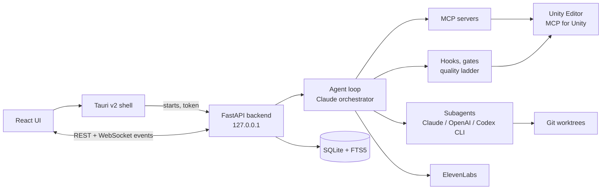

<div align="center">


# GameDevWorkstation

**A local AI agent workstation for solo Unity developers, on your Mac.**

[](#quick-start)
[](#built-for-unity)
[](VERSION)
[](LICENSE)
<br>
[](pyproject.toml)
[](frontend/package.json)
[](src-tauri/Cargo.toml)

[Highlights](#highlights) ·
[Built for Unity](#built-for-unity) ·
[Campaigns](#campaigns-and-workflows) ·
[How it works](#how-it-works) ·
[Security](#security-model) ·
[Quick start](#quick-start) ·
[Full guide](docs/GUIDE.md)

</div>

---

Coding agents are good at writing C#; they are bad at knowing when a game change is actually
*done*. GameDevWorkstation is a desktop app that puts Claude
in charge as the orchestrator, hands units of work to Claude and OpenAI (Codex) subagents in
parallel, and drives the Unity Editor through MCP. The harness, not the model, decides
when a turn may end: it enforces compile and test gates, asks for fresh evidence before a story
is marked done, and keeps your project's taste and past mistakes in front of the agent.
Everything runs locally; the backend listens on `127.0.0.1` only.

## Highlights

| | |
|---|---|
| **Orchestrator + subagents** | Claude plans the job and delegates units to Claude and OpenAI subagents (API or Codex CLI), choosing model tier and effort per unit, with parallel git worktrees for code. |
| **Unity skill pack** | 17 Unity 6 skills behind a router: compile/fix loops, Play Mode verification, headless builds, safe scene/prefab edits, perf and game-feel passes, trailers, shipping. |
| **Unity: MCP or CLI** | Drive Unity through MCP for Unity or the official Unity CLI (live Editor via `com.unity.pipeline`, or batch when it's closed), switchable per project and session, with a status chip and one `unity` tool for the agent. |
| **Hooks and gates** | A hooks engine runs checks at fixed points of a turn: compile before finishing, tests in verify phases, blocked edits to generated files. |
| **Quality ladder L1-L4** | Stories reach `done` only with fresh, app-observed evidence: compile, tests, play evidence and screenshots, design critique. |
| **Taste and scars** | `TASTE.md`, `POSTMORTEMS.md` and an anti-pattern ratchet keep design judgement and past failures in the loop. |
| **Campaigns and workflows** | Multi-session goals with a plan you approve, phases whose checks the app evaluates itself, a campaign file in the project (decisions, discoveries, handoffs), checkpoints, autopilot with budget and stall breakers; or a one-session workflow with `/workflow`. 9 Unity templates ship, including a trailer workflow. |
| **Fleet** | Parallel waves of subagents in their own worktrees, each with a claimed scope, scope-checked merges, a conflict circuit breaker and discoveries relayed to the next wave. |
| **Progressive skill disclosure** | A compact skill index in the system prompt; full skill text is loaded only when used and survives compaction. |
| **Task board** | A Kanban board (Tasks tab) you and the agent share: tasks with codes like `Task00001`, subtasks and checklists, comments, history and linked sessions, live updates. In chat: `/task new`, `/task <code>`, `/task move`, `/task done`, `/task list`, `/task link`; the agent uses `task_*` tools. Scheduled prompts live on the Schedule page. |
| **Cost control** | Daily and per-session spend limits, job budgets, approval for high effort, and a My usage page per model. |
| **Trailer maker** | Brief → beat sheet → scripted Play Mode capture (Unity Recorder) → ffmpeg edit from a JSON edit list → ElevenLabs music cut to the beat sheet → three reviewers → Steam, YouTube and vertical exports. |
| **ElevenLabs** | Speech, transcription, sound effects and music (including composition plans with exact section lengths), in chat and on their own page. |
| **Native shell, local updates** | Tauri v2 app with a frozen FastAPI backend, keys in the macOS Keychain and in-app updates from a local folder. |

## Built for Unity

### The skill pack

`unity-router` is the entry point: it picks which skills a task needs (at most a few at a time)
and whether to work through the Editor (MCP) or batchmode.

| Skill | Purpose |
|---|---|
| [`unity-router`](skills/unity-router/SKILL.md) | Routes a task to the right Unity skills; ships the Unity gates preset |
| [`compile-fix-loop`](skills/compile-fix-loop) | Compile, read the console, fix, repeat, with stop conditions |
| [`play-verify`](skills/play-verify) | Play Mode checks with `[VERIFY]` signals, screenshots and scripted input |
| [`headless-ops`](skills/headless-ops) | Batchmode compile, tests and builds when the Editor is closed |
| [`scene-prefab-safety`](skills/scene-prefab-safety) | Safe scene and prefab edits |
| [`gdd-to-backlog`](skills/gdd-to-backlog) | Turns a GDD into a linted `BACKLOG.md` with acceptance criteria |
| [`project-memory`](skills/project-memory) | `PROJECT.md`: ADRs, conventions, gotchas, current milestone |
| [`architecture-patterns`](skills/architecture-patterns) | Architecture templates for Unity code |
| [`asset-pipeline`](skills/asset-pipeline) | Import settings and asset workflows |
| [`perf-pass`](skills/perf-pass) | Profiling plus the static anti-pattern audit |
| [`game-feel-pass`](skills/game-feel-pass) | Juice and feedback tuning |
| [`build-ship`](skills/build-ship) | Builds and release prep |
| [`vcs-hygiene`](skills/vcs-hygiene) | Git hygiene for Unity projects |
| [`unity-mcp-orchestrator`](skills/unity-mcp-orchestrator) | MCP for Unity tool reference and workflows |
| [`design-critique`](skills/design-critique) | L4 review by three independent reviewers against `TASTE.md` |
| [`postmortem`](skills/postmortem) | Writes `POSTMORTEMS.md` entries and proposes how to enforce the lesson |
| [`trailer-maker`](skills/trailer-maker/SKILL.md) | Brief → capture (Unity Recorder) → ffmpeg edit → ElevenLabs music/VO → platform exports |

General skills ship too: `delegation` (on by default), `game-designer`, `graphify`, `grill-me`,
`claude-handoff` and two Claude delegation strategies.

### Unity: MCP or CLI

Pick how the app drives Unity with the **Unity backend** (Settings → Unity, `[unity] backend` in
`config.toml`; a project default and a per-session choice in the Quality card or the chip under the
composer):

| Backend | Editor open | Editor closed |
|---|---|---|
| `mcp` | [MCP for Unity](https://github.com/CoplayDev/unity-mcp) 10.3 (the built-in `unity` server, through `uvx`) | `headless-ops` `unity.sh` batchmode |
| `cli` | the official [Unity CLI](https://docs.unity.com/en-us/unity-cli) against the open Editor (`unity recompile`, `unity command run_tests`, `eval`, `screenshot`), which needs the `com.unity.pipeline` package | `unity run` / `unity test` / `unity build` in batch mode (else `unity.sh`) |
| `auto` (default) | MCP if it's connected, else the Unity CLI live route | the Unity CLI if it's installed, else `unity.sh` |

The Unity CLI comes with Unity Hub (or `curl -fsSL https://unity.com/install.sh | bash`); the app
finds it in `~/.unity/bin`, the Hub bundle or your `PATH`. In `cli` mode MCP for Unity is never
turned on. When the Editor holds the project and no live route works, nothing runs in batch: the
chip offers to install the Pipeline package (a one-time `Packages/manifest.json` change, behind a
card), to use MCP once, to run on a copy of the project, or to close Unity (it exits without saving,
behind a card). A few batch ops (asset import, menu items, screenshots, forced recompile, builds through unity.sh) need
the small HarnessCli editor scripts; the app installs them on request behind a card, git-excluded so
no tracked file changes. The gates, the
agent's `unity` tool and the Quality card all use the same route; Unity jobs stream to the Terminal
drawer and can be cancelled. Details: [Unity: MCP or CLI](docs/GUIDE.md#unity-mcp-or-cli).

### Quality ladder

A level passes only on evidence that is **observed** by the app itself (an agent's report never
counts), **fresh** (newer than the last change to the files it depends on) and **bound** to a
`BACKLOG.md` story or acceptance criterion.

| Level | Passes when | Observed from |
|---|---|---|
| **L1** Compile | The newest compile is newer than the newest code change, with 0 errors | Unity log / console, compile gate |
| **L2** Behaviour | Each EditMode/PlayMode criterion's tests passed after the last content change | NUnit XML, MCP `run_tests` |
| **L3** Play evidence | Play-verify criteria passed on a fresh log; visual stories have a fresh screenshot | `check_criteria`, screenshots on disk |
| **L4** Critique | `critique()` passed, or you accepted it on the escalation card | Three reviewer subagents |

Flipping a story to `done` in `BACKLOG.md` without the evidence it needs is denied (fail closed).

### Gates

The Unity gates preset ([`skills/unity-router/hooks.toml`](skills/unity-router/hooks.toml)) is
off per project until you accept a one-time offer, which consents to exactly the tools and
commands it runs:

- **block-generated**: edits to `Library/`, `Temp/`, `*.csproj` and other generated files are refused.
- **cs-compile** (L1): a turn that changed code can't finish until the project compiles, with up to 2 fix attempts before it's handed to you.
- **merge-compile**: a worktree merge that brought code is compiled.
- **verify-tests** (L2): EditMode tests in a campaign's verify phase.
- **antipatterns**: a scan of changed scripts; advisory, but blocking in the Performance pass and Release workflows.
- **backlog-lint**: lint errors after `BACKLOG.md` is written.

Your own hook files (`.gamedevworkstation/hooks.toml`) are ignored until you trust them by hash. A
tool-failure breaker stops a turn that keeps hitting the same error.

### Anti-pattern ratchet

[`unity_antipatterns.py`](skills/perf-pass/scripts/unity_antipatterns.py) (stdlib-only Python)
traces hot methods (`Update`, `FixedUpdate`, `On*Stay*` and what they call) and flags
`GetComponent`, `Find*`, `Camera.main`, LINQ, string and collection allocations, `Debug.Log`,
missing event unsubscribes and more, with a weighted score. A baseline in
`.gamedevworkstation/antipatterns-baseline.json` means only *new* findings count.

### Taste, critique and postmortems

- **`TASTE.md`**: three words, ranked heuristics, anti-patterns and hard constraints for your game.
- **`design-critique`**: Spec Auditor, Player Advocate and Art Director review fresh screenshots; the minimum score counts, two rounds at most, then you decide.
- **`POSTMORTEMS.md`**: each rule has an `Applies to:` glob, and the rule is shown to the agent the first time it touches a matching file in a session.

### Trailers

[`trailer-maker`](skills/trailer-maker/SKILL.md) makes a trailer from the real game, never from generated
footage. You settle a brief (type, one-sentence core message, length, platforms, CTA); the agent writes a beat sheet
with the hook inside 10 seconds and a shot list, and `Harness.Trailer` records each shot in Play Mode with the Unity
Recorder (several takes, scripted setups and input). A JSON edit list is rendered by stdlib Python scripts driving
`ffmpeg`: cuts and dissolves, cards and overlays, music cut to the beat sheet with an ElevenLabs composition plan, VO
with ducking, −14 LUFS loudness, captions. Contact sheets go to three reviewer subagents (Muted Scroller, Trailer
Editor, Platform & Accessibility Auditor); the minimum score must reach the pass score (7 by default), with two rounds
at most before you decide. Exports: a Steam master at 1080p with a poster frame, YouTube, and a 9:16 cut for Shorts
and TikTok (X on request), each checked by `qc`. Rendered videos appear as items and play inline. The skill also
ships a `trailer` workflow template (brief → beat sheet → shot list → capture → rough cut → music → review →
exports) for chains and campaigns.

Needs `ffmpeg` on your PATH (`brew install ffmpeg`; not bundled) and the `com.unity.recorder` package; capture
needs the Editor open, because the Recorder doesn't run in batchmode.

### Gallery

The **Gallery** card (side panel, under Outputs) shows the images, videos and audio a session made. Type what a
screenshot should show ("player at the cave entrance, night, low angle") and a short side agent frames the shot in
Unity and captures it: through MCP for Unity or the Unity CLI with the Editor open, or a batch render
(`unity.sh screenshot`) with the Editor closed. Captures only write into `Logs/harness/screenshots/`;
the agent never edits project source files or saves a scene. Approval cards depend on the route, Play Mode
exit is best effort, and switching to Plan only mode refuses further captures and play calls. Details:
[Gallery](docs/GUIDE.md#gallery).

## Campaigns and workflows

A **workflow** (chain) runs a fixed sequence of phases in one session: type
`/workflow <id> <what to do>` in the composer, or pick one under **Workflows** in the skills
menu. A **campaign** spreads a larger goal over several sessions: a planning session writes the
design target and scope into `.gamedevworkstation/campaigns/<slug>.md`, a validator checks the plan covers
your request, you approve it, and each phase then runs in a fresh session with a brief built from
the campaign file. Either way the agent declares a phase done with a handoff and the **app**
checks the phase's conditions (files, scripts, gates, quality-ladder levels, fresh screenshots,
your own Pass/Fail); a failure costs a retry, and the last one parks the run for you.

| Template | Phases |
|---|---|
| `new-mechanic` New mechanic | Spec → backlog story → code → compile → behaviour tests → play-verify → commit |
| `bugfix` Bug fix | Reproduce with a failing test → fix → repro test and suite pass → commit |
| `juice-pass` Juice pass | Baseline screenshots → game-feel pass → before/after evidence → design critique → commit |
| `content-batch` Content batch | Plan the items → produce them (a Fleet wave, one unit per item folder) → wire → verify |
| `perf-pass` Performance pass | Baseline perf report → fix loop (anti-pattern gate blocking) → compare |
| `release` Release | Freeze → full tests → build → headless smoke → spec-audit critique → changelog and tag |
| `replace-system` Replace a system | Build beside → parity verify → switch → remove the old system |
| `milestone` Milestone (campaign only) | One phase per story of the current milestone, then the milestone exit |
| `trailer` Trailer (from `trailer-maker`) | Brief → beat sheet → shot list → capture → rough cut → music, VO and SFX → trailer review → exports |

The **Campaigns** page lists every run with its status, phase, spend and checks, and has Pause,
Resume, Park, Abandon, Rollover and the checkpoint refs (the app never resets your tree; it shows
the restore command). Autopilot continues a running campaign while there is progress, within its
budget, turn and session limits. Parked, waiting and finished runs show a notice on any page.
Task codes (`Task00012`) in a campaign's request link its sessions to those tasks.

## How it works



The Tauri shell starts the frozen backend on a random port with a random token and shows the UI.
The backend runs the agent loop, subagents, MCP servers and gates; every change is published on
an event bus and streamed to the window over a WebSocket, which replays what it missed after a
reconnect. Config and data live under `~/Library/Application Support/GameDevWorkstation/`, logs under
`~/Library/Logs/GameDevWorkstation/`.

## Security model

- **Approvals and allowlist.** Shell commands, deletes, edits in Ask mode, non-read-only MCP tools
  and effort above high show an approval card. Allowlist rules (`run_command:git status*`) never
  match command lines with `;`, `|`, `$(…)` and similar.
- **Modes.** Plan only, Ask and Accept edits; in Plan only no rule lets an edit or command through.
- **Untrusted content.** Web, MCP, subagent and Unity console output reaches the model inside
  randomly tagged `<untrusted-…>` blocks, marked as data, never instructions.
- **Secrets.** API keys and secret-looking MCP env vars and headers live in the macOS Keychain;
  the UI shows only the last four characters.
- **Isolation.** Hook files need trust by hash; the app's own git calls disable repository hooks;
  `web_fetch` refuses private and local addresses.

## Quick start

**Prerequisites:** macOS 13+ on Apple Silicon, Xcode Command Line Tools, Node 20+,
[uv](https://docs.astral.sh/uv/) (Python 3.11+), Rust stable (for the desktop app), and
optionally the Codex CLI (`npm i -g @openai/codex`).

```bash
git clone https://github.com/ArshiaJahan/GameDevWorkstation.git
cd GameDevWorkstation
make dev        # build the UI, start the backend on 127.0.0.1:8765, open it in your browser
```

Add keys in **Settings → Accounts** (Anthropic required; OpenAI and ElevenLabs optional). To
click around without keys, run with `GDW_FAKE_PROVIDERS=1`.

| Command | What it does |
|---|---|
| `make dev` | Build the UI and run the backend in your browser |
| `make backend` + `make ui` | Backend plus hot-reloading UI on :5173 |
| `make live` | The desktop window from this checkout, with UI hot reload |
| `make app` | Build `dist/GameDevWorkstation.app` and `dist/GameDevWorkstation.dmg` (ad-hoc signed) |
| `make install` | Copy the built app to `/Applications` |
| `make release` | Bump the version and publish to the local updates folder |
| `make test` | Backend tests, UI type check and UI tests |

**For Unity:** install `com.coplaydev.unity-mcp` in your project, run
`uvx --from mcpforunityserver==10.3.0 mcp-for-unity` once while online to cache the server, open
the Editor, and invoke `unity-router` from the composer's skill button or with `/skill unity-router`.
Or skip MCP: with the official Unity CLI installed (Unity Hub ships it), set the Unity backend to
CLI in Settings → Unity; batch jobs need nothing in the project, the live Editor route needs the
`com.unity.pipeline` package (the chip offers to add it).

### Configuration

Defaults ship with the app; [`config.example.toml`](config.example.toml) lists them with
comments. Your `config.toml` holds only what you change, and most of it is editable in Settings:
model tiers, delegation budgets, spend limits, modes and allowlist, `[skills]`, `[hooks]`,
`[ladder]`, `[campaigns]`, `[fleet]` and `[unity]` (the Unity backend: `auto`, `mcp` or `cli`, the
Unity CLI path and the Unity job timeouts). See the [guide](docs/GUIDE.md#configuration).

<details>
<summary><b>Project layout</b></summary>

```
backend/gamedevworkstation/   FastAPI backend
  agent/                      agent loop and context
  providers/                  Anthropic, OpenAI and ElevenLabs adapters
  features/                   subagents, worktrees, MCP, hooks, ladder, unity_bridge, updates, ...
frontend/src/                 React UI (Vite)
src-tauri/                    Tauri v2 desktop shell
skills/                       built-in skills (Unity pack, delegation, design tools)
scripts/                      build, release, version and dev scripts
packaging/                    PyInstaller packaging
tests/                        backend tests (pytest)
docs/GUIDE.md                 the full manual
config.example.toml           default configuration with comments
```

</details>

<details>
<summary><b>Development and testing</b></summary>

```bash
uv run pytest -q                          # backend tests; no network
cd frontend && npx tsc -b && npx vitest run   # UI type check and tests
make test                                 # both of the above
make test-live                            # real API smoke tests (skipped without keys)
make app-test                             # build, launch and check the app
```

The unit tests run against recorded provider fixtures and fakes (a fake `codex` binary, a fake
Unity bridge), so they need no keys. Live API paths have not yet been exercised end to end;
`make test-live` and `make app-test` are the first runs against real APIs.

Contributions are welcome: open an issue to discuss a change, keep pull requests focused, and
run `make test` before submitting.

</details>

## Documentation

The [full guide](docs/GUIDE.md) covers every page and panel, sessions, campaigns and
workflows, keyboard shortcuts, delegation rules, MCP and skills, building the app, versions and updates, where data lives, and
troubleshooting.

## Acknowledgements

- The campaign file sections, exit-evidence table, discovery records, scope claims, lifecycle hook
  ideas and postmortem format are adapted from [Citadel](https://github.com/SethGammon/Citadel)
  by Seth Gammon (MIT). See [THIRD_PARTY_NOTICES.md](THIRD_PARTY_NOTICES.md).
- Unity Editor control uses [MCP for Unity](https://github.com/CoplayDev/unity-mcp) by Coplay.
- Built with [Tauri](https://tauri.app), [FastAPI](https://fastapi.tiangolo.com),
  [React](https://react.dev) and [Vite](https://vite.dev).

## License

[MIT](LICENSE) © 2026 ArshiaJahan
